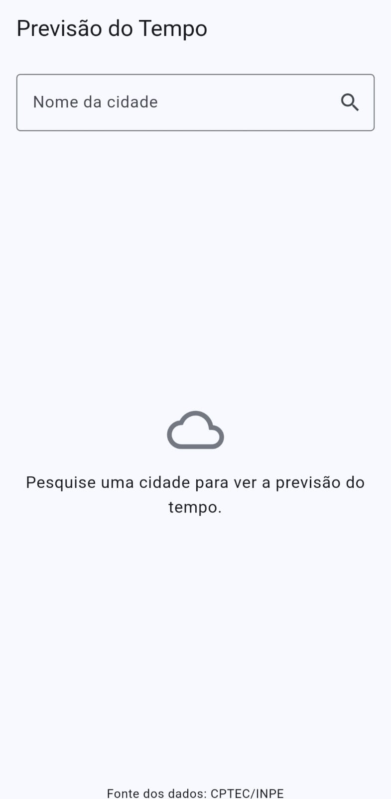
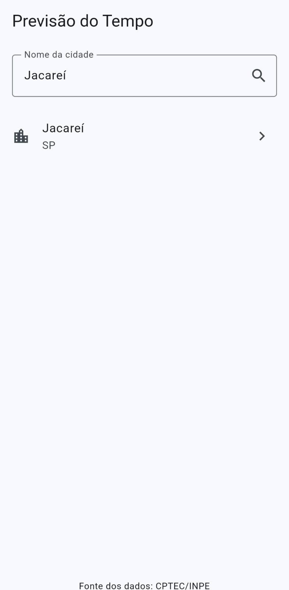
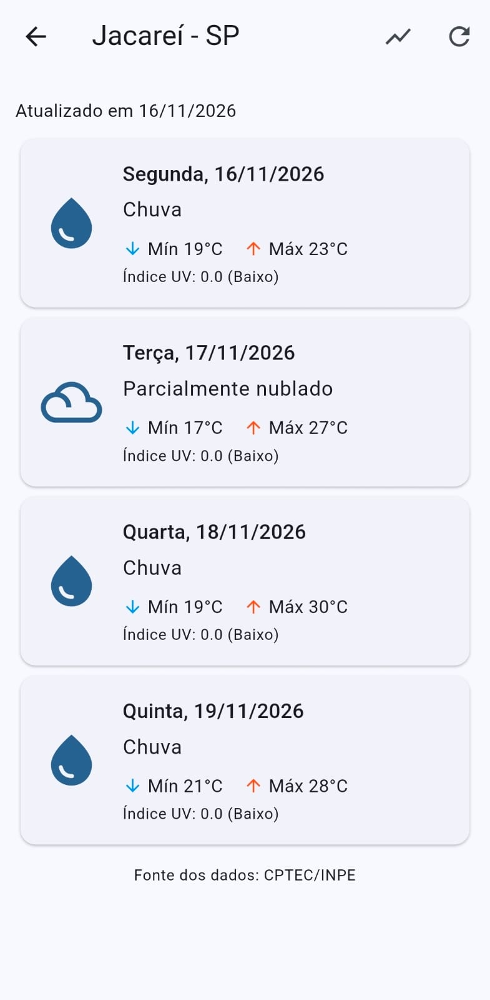
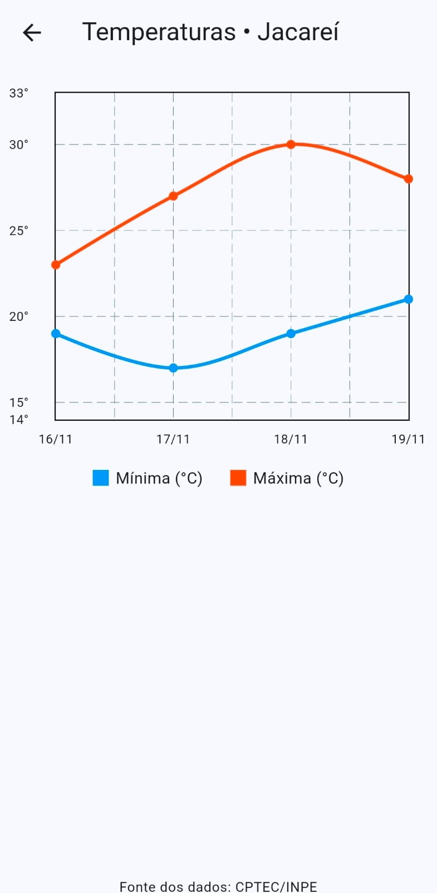
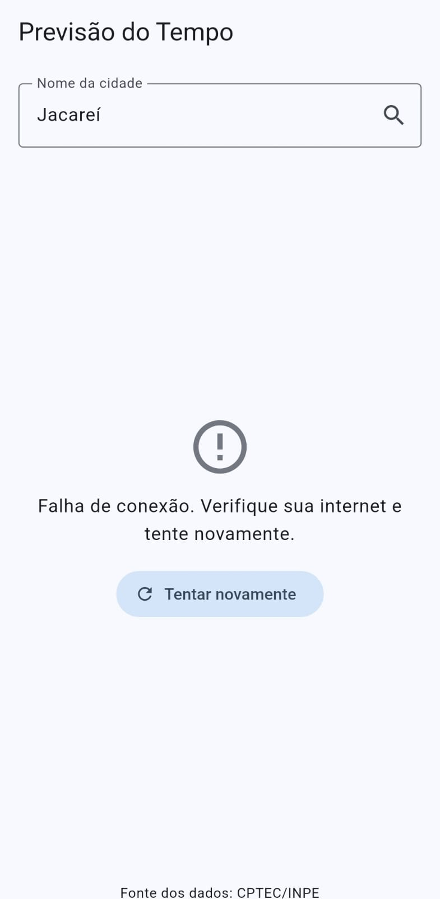

# Previsão do Tempo - CPTEC/INPE

Aplicativo Flutter que consulta a previsão do tempo de cidades brasileiras usando o
serviço em **XML** do CPTEC/INPE (<https://servicos.cptec.inpe.br/XML/>).

> **Fonte dos dados: CPTEC/INPE.** O app exibe essa informação em todas as telas,
> conforme os termos de uso do serviço.

## Funcionalidades

- **Pesquisa de cidades** - o usuário digita o nome (acentos são removidos
  automaticamente, como exige o serviço) e o app consulta `listaCidades?city=...`.
  A lista mostra nome e UF; o `id` usado nas consultas é o retornado pelo serviço.
- **Previsão para 4 dias** - `cidade/{id}/previsao.xml`. Todos os dias retornados são
  exibidos, cada um com data, temperatura mínima/máxima (°C), descrição da condição,
  ícone e índice UV (com classificação), quando disponível. A data de atualização
  informada pelo serviço também é mostrada.
- **Siglas convertidas** - as siglas `ps, pn, pc...` viram descrições legíveis
  conforme a documentação do CPTEC/INPE (`lib/utils/weather_conditions.dart`).
- **Gráfico de temperaturas** - linhas de mínima e máxima por dia (fl_chart).
- **Navegação entre telas** - começa em Pesquisa, depois Previsão e por fim Gráfico (`Navigator.push`).
- **Atualização** - botão de atualizar na barra superior e *pull-to-refresh*.
- **Tratamento de erros** - indicador de carregamento; mensagem quando nenhuma cidade
  é encontrada; falha de conexão, tempo esgotado, serviço indisponível se o HTTP não retornar o 200, XML inválido/inesperado; mensagem quando não há previsão; campos ausentes são
  tolerados (`--` na temperatura, ícone genérico, UV omitido).
- **Histórico e uso offline** - cidades consultadas e última previsão ficam salvas.

## Como executar

Pré-requisitos: Flutter SDK 3.19+, Dart 3.3+ e um emulador ou dispositivo.

```bash
flutter create .
flutter pub get
flutter run
flutter test
```

O app usa HTTPS, então não exige exceções de segurança no iOS ou Android. A versão
web não é suportada, pois o serviço não envia cabeçalhos CORS.

## Bibliotecas

| Pacote | Uso |
|---|---|
| `http` | Requisições HTTP ao serviço do CPTEC/INPE |
| `xml` | Interpretação das respostas XML |
| `shared_preferences` | Persistência local |
| `fl_chart` | Gráfico de temperaturas |

## Estratégia de persistência local

É utilizado `shared_preferences` como a chave/valor, adequada ao pequeno volume de dados.
Os objetos são serializados em JSON em `lib/services/storage_service.dart`:

| Chave | Conteúdo |
|---|---|
| `recent_cities` | Lista com máximo de 8 das cidades consultadas, da mais recente para a mais antiga; o 1º item é a última cidade. Exibida na tela inicial. |
| `forecast_cache_<id>` | Última previsão obtida com sucesso para cada cidade. |

Se uma consulta falhar, como por sem internet ou serviço fora do ar, o app mostra a última
previsão salva com um aviso. Previsões vazias não sobrescrevem o cache. As leituras e
escritas são protegidas por `try/catch`, e os dados corrompidos são descartados.

## Estrutura

```
lib/
├── main.dart
├── models/        city.dart, forecast.dart
├── services/      cptec_service.dart (HTTP + XML), storage_service.dart
├── utils/         weather_conditions.dart (siglas/ícones), formatters.dart
├── screens/       search_screen.dart, forecast_screen.dart, chart_screen.dart
└── widgets/       message_view.dart
```

## Capturas de tela


| Pesquisa | Resultados | Previsão | Gráfico | Erro de sem conexão |
|---|---|---|---|---|
|  |  |  |  |  |

## Termos de uso

Os dados pertencem ao CPTEC/INPE, não podem ser usados para fins comerciais sem
autorização e devem sempre citar a fonte "CPTEC/INPE".
